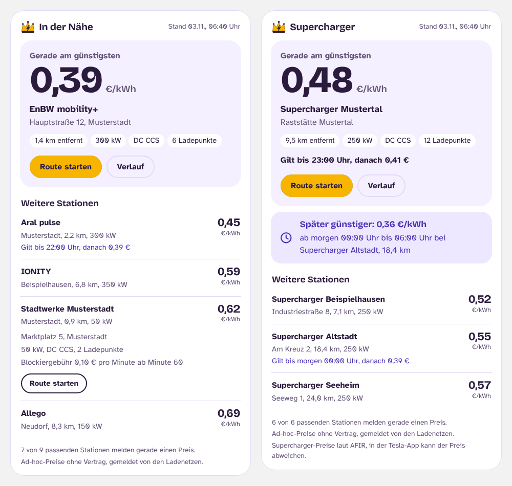
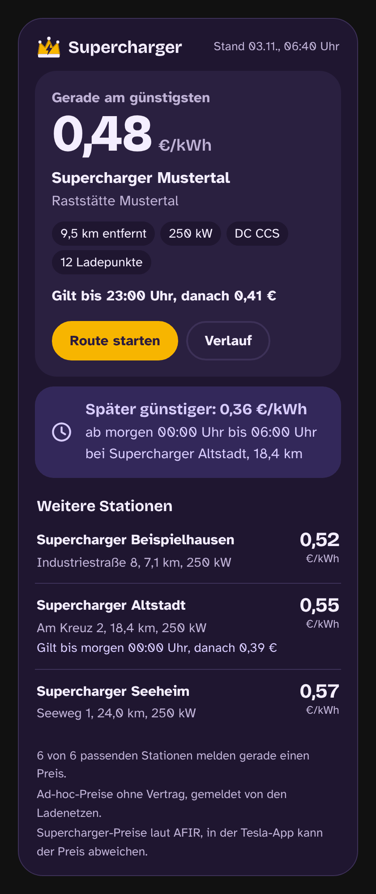

# Ladekrone


Günstigste **Ad-hoc-Ladepreise** in deiner Umgebung, direkt in Home Assistant – so wie Tankerkönig für Sprit, nur für Ladesäulen.

Ohne Home Assistant: Die **[Web-App](https://uekala.github.io/ladekrone/app/)** zeigt dieselben Preise auf dem Handy, auch für später am Tag. Sie lässt sich auf den Startbildschirm legen und funktioniert offline mit den zuletzt geladenen Preisen.

Seit der EU-Verordnung AFIR müssen alle Ladenetze Standorte, Leistung und Ad-hoc-Preise maschinenlesbar über den nationalen Zugangspunkt [Mobilithek](https://mobilithek.info/) bereitstellen. Ladekrone macht diese Daten in Home Assistant nutzbar – ohne dass du selbst einen Mobilithek-Zugang brauchst.

## Was es kann

- **Günstigster Preis** im Umkreis als Sensor (€/kWh), mit Ladenetz, Adresse, Entfernung, Leistung, Blockiergebühr und den fünf günstigsten Alternativen
- **Tageszeitpreise** werden berücksichtigt, z. B. der günstigere Nachttarif an Superchargern. Zu jedem Angebot steht, **bis wann** der Preis gilt und was danach kommt
- **Feiertagstarife** werden nach den Feiertagen des Bundeslands der Station ausgewertet, z. B. Fronleichnam in NRW, aber nicht in Niedersachsen
- **Günstigster Preis in den nächsten 24 Stunden** als eigener Sensor, mit Zeitfenster („ab 23:00 in Moers für 0,39 €“)
- **Suche, die mitfährt**: Der Mittelpunkt kann einer Entität folgen, z. B. dem Auto oder einer Person
- **Filter** nach Mindestleistung, AC/DC, Stecker und Ladenetz
- **Mehrere Suchgebiete**: zum Beispiel „Zuhause“, „Arbeit“ und „nur Supercharger“
- **Namen statt Kürzeln**: Wo ein Ladenetz nur seine ID meldet (z. B. `DE*EWE`), steht der Firmenname
- Der Preissensor trägt Koordinaten und erscheint dadurch auf der Karte
- **Eigene Dashboard-Karte** im Look der Web-App, ohne Zusatzkarten

## Web-App

[uekala.github.io/ladekrone/app](https://uekala.github.io/ladekrone/app/)

- Standort verwenden oder Ort bzw. PLZ suchen. Die Suche läuft auf dem Gerät, ohne fremden Suchdienst
- Günstigster Preis im Umkreis, darunter alle weiteren Stationen mit Preis
- **Später günstiger**: der günstigste Preis der nächsten 24 Stunden mit Zeitfenster
- Filter nach Leistung, Umkreis, Ladenetz und Stecker
- Route mit einem Tipp in Apple Karten oder Google Maps
- Keine Konten, keine Cookies, kein Tracking; der Standort bleibt auf dem Gerät

Die Preislogik ist dieselbe wie in der Integration; ein Test vergleicht beide.

## So funktioniert es

```
Mobilithek (AFIR-Angebote der Ladenetze)
   │  täglich, GitHub Action mit Client-Zertifikat
   ▼
GitHub Pages: kompakte JSON-Kacheln (0,25° × 0,25°)
   │  alle 6 Stunden, nur die Kacheln im eigenen Umkreis
   ▼
Home Assistant: Preise alle 5 Minuten neu bewertet (Zeitfenster!)
```

Deine Position verlässt Home Assistant nicht – abgerufen werden nur ganze Kacheln. Folgt die Suche einer Entität, werden beim Ortswechsel nur die fehlenden Kacheln nachgeladen.

## Installation über HACS

1. HACS → Integrationen → ⋮ → **Benutzerdefinierte Repositories**
2. `https://github.com/uekala/ladekrone` als Kategorie **Integration** hinzufügen
3. **Ladekrone** installieren und Home Assistant neu starten
4. Einstellungen → Geräte & Dienste → **Integration hinzufügen** → Ladekrone

**Umstieg von Ladekönig:** Bis Version 0.2 hieß das Projekt Ladekönig. Alte Integration in HACS entfernen, dieses Repository hinzufügen, Ladekrone installieren und die Suchgebiete neu anlegen.

## Einrichtung

| Feld | Bedeutung |
|------|-----------|
| Name | Name des Suchgebiets, z. B. „Zuhause“ |
| Suchgebiet | Mittelpunkt und Radius auf der Karte (0,5–50 km) |
| Mindestleistung | Alle, ab 22 kW, ab 50 kW oder ab 150 kW |
| Stromart | Alle, AC oder DC |
| Stecker | Alle, CCS, Typ 2 oder CHAdeMO |
| Preis | Ad-hoc, oder Vertrag bzw. Abo, wenn der Betreiber diesen Tarif in der Mobilithek veröffentlicht. Sonst gilt der Ad-hoc-Preis und ist als solcher gekennzeichnet |
| Nur diese Ladenetze | Optional, kommagetrennt, z. B. `Tesla` oder `EnBW, Ionity` |
| Ladenetze aus Entität | Optional: Liest weitere Ladenetze aus dem Attribut `operators` einer Entität (Liste aus Namen oder aus Einträgen mit `name`), z. B. `sensor.ladecockpit_multipass` aus [Ladecockpit](https://github.com/uekala/ladecockpit) mit den Ladenetzen, an denen Tesla MultiPass schon funktioniert hat. Die Liste wächst mit, es zählen alle Stationen dieser Netze. Solange kein Ladenetz bekannt ist, wird nichts vorgeschlagen |
| Mittelpunkt folgt | Optional: `device_tracker`, `person` oder `zone`. Die Suche wandert mit; ohne aktuelle Position gilt das Suchgebiet oben |

Alles lässt sich später über **Konfigurieren** ändern.

## Sensoren

| Sensor | Inhalt |
|--------|--------|
| Günstigster Preis | Aktuell günstigster Ad-hoc-Preis in €/kWh. Attribute: `operator`, `address`, `distance_km`, `power_kw`, `current_type`, `connectors`, `minute_fee`, `minute_fee_from`, `session_fee`, `price_updated`, `latitude`, `longitude`, `offers` (Top 5). Bei zeitabhängigen Tarifen zusätzlich `until` (Preis gilt bis) und `next_price` (Preis danach), auch in jedem Eintrag von `offers` |
| Günstigster Preis in 24 h | Niedrigster Preis, der in den nächsten 24 Stunden im Umkreis erreicht wird. Attribute wie oben plus `from`, `until` und `now` (gilt schon jetzt) |
| Durchschnittspreis | Mittlerer aktueller Ad-hoc-Preis aller passenden Stationen mit Preis im Umkreis. Attribute: `stations`, `min_price`, `max_price` |
| Ladestationen im Umkreis | Passende Stationen. Attribute: `with_price` (davon mit Preis), `networks` (Ladenetze aus der Entität, falls eingestellt), `center_source` (`fixed` oder die Entität, der die Suche folgt), `center_latitude`, `center_longitude` |
| Datenstand | Zeitpunkt der letzten Datenaufbereitung (Diagnose) |

## Dashboard-Karte

Ladekrone bringt eine eigene Karte mit, die aussieht wie die Web-App: der günstigste Preis groß, darunter Ladenetz, Adresse, Leistung und „Route starten“, „Später günstiger“ für die nächsten 24 Stunden und die weiteren Stationen zum Aufklappen. Supercharger erscheinen mit ihrem Ort („Supercharger Mustertal“), mit dem Hinweis, dass der Preis in der Tesla-App abweichen kann. Hell und dunkel folgen Home Assistant. Mushroom, card-mod oder andere Zusatzkarten sind nicht nötig.

<p>


</p>

<sub>Beispiel mit erfundenen Daten.</sub>

Die Karte wird mit der Integration geladen. Ladekrone trägt sie dafür auch unter Einstellungen → Dashboards → Ressourcen ein und hält die Version dort aktuell (nicht bei Dashboards im YAML-Modus). Im Dashboard „Karte hinzufügen“ wählen und nach „Ladekrone“ suchen, oder in YAML:

```yaml
type: custom:ladekrone-card
entity: sensor.ladekrone_gunstigster_preis
```

| Option | Inhalt |
|--------|--------|
| `entity` | Sensor „Günstigster Preis“ eines Suchgebiets (Pflicht). „Später günstiger“, Datenstand und Anzahl der Stationen holt die Karte vom selben Suchgebiet. |
| `title` | Überschrift, Standard ist der Name des Suchgebiets |
| `show_list` | Weitere Stationen zeigen, Standard `true` |

Nach einem Update von Ladekrone die Seite einmal neu laden, damit der Browser die neue Karte nimmt.

## Beispiele

**Benachrichtigung, wenn der Supercharger in der Nähe günstig wird** (Eintrag nur für das Ladenetz `Tesla`):

```yaml
alias: Supercharger günstig
triggers:
  - trigger: numeric_state
    entity_id: sensor.supercharger_gunstigster_preis
    below: 0.40
actions:
  - action: notify.notify
    data:
      title: Supercharger günstig
      message: >-
        {{ state_attr('sensor.supercharger_gunstigster_preis', 'address') }}:
        {{ states('sensor.supercharger_gunstigster_preis') }} €/kWh
mode: single
```

**Hinweis vor dem Nachttarif** (Eintrag nur für das Ladenetz `Tesla`):

```yaml
alias: Supercharger-Nachttarif
triggers:
  - trigger: template
    value_template: >-
      
      {{ f is not none and (as_datetime(f) - now()).total_seconds() < 1800
         and not state_attr('sensor.supercharger_gunstigster_preis_in_24_h', 'now') }}
actions:
  - action: notify.notify
    data:
      message: >-
        Ab {{ as_datetime(state_attr('sensor.supercharger_gunstigster_preis_in_24_h', 'from')).strftime('%H:%M') }}
        {{ states('sensor.supercharger_gunstigster_preis_in_24_h') }} €/kWh
        in {{ state_attr('sensor.supercharger_gunstigster_preis_in_24_h', 'address') }}
mode: single
```

**Dashboard-Karte mit den günstigsten Säulen:**

```yaml
type: markdown
content: >-
  
  **{{ '%.2f' | format(o.price) }} €/kWh** · {{ o.operator }} · {{ o.distance_km }} km · {{ o.power_kw }} kW
  
```

Die Entitäts-IDs hängen vom gewählten Namen ab.

## Datenquelle und Lizenzen

- Grundlage sind die AFIR-Datenangebote der Ladenetze in der Mobilithek (DATEX II v3): statische Angebote und, wo abonniert, die dynamischen Preisaktualisierungen.
- Verarbeitet werden nur Angebote mit offener Lizenz (CC0, CC BY 4.0, DL-DE). Die genutzten Quellen und Namensnennungen stehen auf der [Datenseite](https://uekala.github.io/ladekrone/) und im Attribut `attribution` des Preissensors.
- Die Daten werden aufbereitet: Nettopreise in Bruttopreise umgerechnet, Ladepunkte gruppiert, nach Kacheln aufgeteilt.
- Stationen mit Feiertagstarif bekommen ihr Bundesland. Die Landesgrenzen dafür stammen aus [Natural Earth](https://www.naturalearthdata.com/) (gemeinfrei).
- **Ad-hoc-Preise** sind die Preise ohne Vertrag. Mit Ladekarte oder App kann es günstiger oder teurer sein. Veröffentlicht ein Ladenetz in derselben Meldung zusätzlich einen Vertrags- oder Abotarif, kann das Suchgebiet den bevorzugen. Der eigene Preis deiner Karte steht dort nicht.
- Alle Angaben ohne Gewähr.

- Welche Quelle wie viele Stationen und Preise liefert und welche abonnierten Quellen gerade nichts liefern, zeigt die Datenseite. Eine [Diagnose je Quelle](https://uekala.github.io/ladekrone/v1/diag.json) listet Tarifarten, Preistypen, Sondertage wie Feiertage (`special_days`) und Beispieldaten.

## Grenzen (Version 0.5)

- Die Daten werden einmal täglich aufbereitet. Dynamische Preise kommen deshalb mit bis zu einem Tag Verzug an.
- Nicht alle Ladenetze melden schon an die Mobilithek, und nicht jede gemeldete Säule hat einen Preis. Qwello meldet derzeit weder statisch noch dynamisch Preise.
- Nur Deutschland.
- Gelesen wird DATEX II v3 als JSON. Das schreibt der Leitfaden der Mobilithek für AFIR-Angebote vor; alle abonnierten Angebote liefern es.
- Feiertage gelten je Bundesland. Feiertage einzelner Gemeinden (Mariä Himmelfahrt in Teilen Bayerns, Fronleichnam in Teilen Sachsens und Thüringens, Augsburger Friedensfest) zählen nicht. An einer Landesgrenze kann eine Station dem Nachbarland zugeordnet sein.
- Ferien, Schultage und Veranstaltungstage als Sondertage lassen sich nicht bestimmen und gelten als nicht zutreffend.

## Datenquelle selbst betreiben

Für Forks oder eine eigene Datenquelle:

1. Auf [mobilithek.info](https://mobilithek.info/) registrieren, eine Organisation anlegen bzw. beitreten und die Rolle **Bestellmanagement** erhalten.
2. Unter „Mein Profil“ ein **Maschinenkonto** mit Zertifikat anlegen und die `.p12`-Datei samt Passwort sichern.
3. Die gewünschten Angebote aus `collector/sources.json` **abonnieren** (Feld `offer`, für dynamische Preise `dynamic.offer`) und die Abo-IDs notieren.
4. Im GitHub-Repository unter *Settings → Secrets and variables → Actions* anlegen:
   - `MOBILITHEK_CERT_P12_BASE64` – Ausgabe von `base64 -w0 zertifikat.p12`
   - `MOBILITHEK_CERT_PASSWORD` – Passwort des Zertifikats
   - `MOBILITHEK_SUBSCRIPTIONS` – JSON mit deinen Abo-IDs, z. B. `{"tesla": "1234…", "qwello_dyn": "5678…"}`. Schlüssel ist der `key` der Quelle, für dynamische Angebote mit Endung `_dyn`. Die Einträge überschreiben die Abo-IDs in `sources.json`, die nur mit dem Zertifikat dieses Projekts funktionieren.
5. Unter *Settings → Pages* als Quelle **GitHub Actions** wählen.
6. Workflow **Daten sammeln** einmal manuell starten.

GitHub pausiert zeitgesteuerte Workflows in öffentlichen Repositories nach 60 Tagen ohne Aktivität. Dann den Workflow unter *Actions* wieder aktivieren.

Lokal testen mit einer heruntergeladenen Angebotsdatei:

```bash
cd collector
python -m ladekrone_collector --sources sources.json --out ../public --input tesla=/pfad/zur/datei.json
```

## Entwicklung

```bash
pip install -r requirements_test.txt ruff
ruff check . && ruff format --check .
pytest
```

## Lizenz

MIT – siehe [LICENSE](LICENSE).

Die Schriften der Karte, Atkinson Hyperlegible und Bricolage Grotesque, stehen unter der SIL Open Font License (`custom_components/ladekrone/frontend/fonts`).
